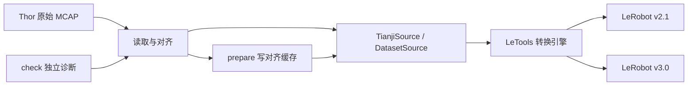

# 内部设计（0.6.1）

[返回使用手册](../README.md) · [参数详解](PARAMETERS.md) · [检查与报错](CHECKS.md)

## 为什么使用独立 provider

LeTools 负责通用转换规划和目标格式；Tianji 包负责原始机器人数据的含义。MCAP 如何解码、左右臂怎样映射、时间戳取什么来源、夹爪怎样标定、无命令时填什么，都属于源数据契约。LeRobot v2.1/v3.0 的物理目录与分片由上游后端维护，避免插件重复实现。



这个图表达逻辑关系：check 复用读取与对齐算法，但不会把检查产生的表格自动传给下一次独立 prepare。两个命令是独立进程；报告也不是转换授权文件。

## SourceProvider 与 DatasetSource 的职责

`TianjiProvider` 是工厂和 CLI 适配层；`TianjiSource` 是 LeTools 真正读取的数据对象。注册对象来自 [provider.py](../src/tianji_provider/provider.py) 中的 `provider = TianjiProvider()`。

```toml
[project.entry-points."letools.source_providers"]
tianji = "tianji_provider.provider:provider"
```

| Provider 成员 | 当前实现 |
|---|---|
| `name` | `tianji`，供 `--source-format` 选择 |
| `api_version` | `2`，插件/配置契约版本，不是 Python 包版本或目标数据版本 |
| `config_type` | 不可变 dataclass `TianjiConfig` |
| `add_arguments()` | 只注册本源格式的参数，不把它们混到其他 provider 中 |
| `config_from_args()` | 生成配置并通过 `__post_init__` 校验 task、FPS、阈值、选项 |
| `open(path, config)` | 返回 `TianjiSource`；此时不扫描录制、不解码、不写文件 |
| `config_to_dict()` / `config_from_dict()` | 继承上游基类的配置序列化支持 |
| `distributed_spec()` | 当前显式抛出 NotImplementedError；有序列化能力不代表已支持分布式执行 |

| DatasetSource 成员 | 提供给 LeTools 的内容 |
|---|---|
| `metadata` | DatasetMetadata：FPS、字段、机器人类型、task、总帧数/episode 数、源审计信息 |
| `episodes` | 稳定顺序的 Episode 元组：索引、长度、任务、统计、媒体描述 |
| `read_episode()` | 一个 episode 的 PyArrow Table |
| `media_input()` | 继承基类，从 episode 取某相机的 FrameSequence 或 VideoSlice |
| `data_profile()` / `media_profile()` | 数据大小、共享资源和 locality 描述，帮助规划读取/编码任务 |
| `planner_identity()` | 当前格式、媒体实现标识及配置哈希；用于区分计划语义，不是源文件完整性哈希 |
| `reports` / `audit()` | Tianji 的扩展审计接口，不是所有 provider 都必须提供 |

首次访问 metadata/episodes 等属性触发 `_loaded`，结果由 `cached_property` 保留。原始源按 bag 有界并行读取/对齐，仅将保留的数组、时间审计和小型报告传回父进程，不传原始高频 signals 或 codec。父进程按原始排序生成 episode/global index、Arrow 表和统计，并保持先检查尺寸再报告该 bag 对齐错误的顺序。图像统计仍在父进程执行。缓存源读取清单并建立描述符，表格按 episode 从 Parquet 读取。

## 模块分工与数据生命周期

| 模块 | 职责 | 为什么独立 |
|---|---|---|
| [provider.py](../src/tianji_provider/provider.py) | 插件注册、配置与参数 | 保持发现/构造轻量，昂贵依赖在使用时加载 |
| [reader.py](../src/tianji_provider/reader.py) | 文件发现、MCAP/schema/CDR 解析、单位和时钟校验 | 集中原始格式契约，避免 CLI 与转换各写一套解析 |
| [decoder.py](../src/tianji_provider/decoder.py) | 每个 schema 预编译消息类及字段读取计划 | 消除逐消息的重复类型构造，仍完整解码所有字段 |
| [alignment.py](../src/tianji_provider/alignment.py) | 网格、有效性、重采样、命令补齐、首尾裁剪 | 使用数组算法，供 source 和 diagnostics 共用 |
| [media.py](../src/tianji_provider/media.py) | H.264 顺序解码、四宫格裁分、PPM 帧、图像统计 | 将大体积图像保持为有界流式处理 |
| [source.py](../src/tianji_provider/source.py) | 原始/缓存双路径、Arrow 表、Episode、DatasetMetadata、审计 | 对上游暴露统一只读 DatasetSource |
| [diagnostics.py](../src/tianji_provider/diagnostics.py) | 逐条检查、错误分类、缺口明细与进度回调 | 允许数值/视频独立检查，一条失败后仍检查其他条 |
| [execution.py](../src/tianji_provider/execution.py) | 有界 spawn 进程调度、失败清理 | 执行资源独立于数据语义；任务异常、意外退出、提前关闭均回收进程 |
| [prepare.py](../src/tianji_provider/prepare.py) | 缓存写入、H.264 编码、完成清单、复用判断 | 把有副作用的准备操作与只读 source 分开 |
| [cli.py](../src/tianji_provider/cli.py) | check/inspect/prepare 子命令、报告与退出码 | 提供辅助工具，不承担目标 LeRobot 后端职责 |
| [__init__.py](../src/tianji_provider/__init__.py) | 包版本和 LeTools 导入引导 | 避免入口发现与直接导入 provider 子模块时的初始化顺序问题 |
| [tests/test_wrench_windows.py](../tests/test_wrench_windows.py) / [test_recording_integration.py](../tests/test_recording_integration.py) | 高频力窗口和可选真实录制端到端验收 | 验证源样本、时间网格、缓存和两个 LeRobot 后端 |
| [tests/test_command_coverage.py](../tests/test_command_coverage.py) | 命令覆盖、缺口、裁剪与缓存版本回归 | 固定 0.6.0 的边界行为 |

普通 source 用 metadata 识别录制，check 则额外识别 `my_bag-*` 或含 data/video 的不完整目录，使错误可见；两者都不静默修复文件。Metadata 引用路径必须存在且位于相应 bag 目录内，MCAP 按清单顺序读取，避免文件名排序打乱分片。

## 读取契约

数值 MCAP 使用嵌入的 ROS 2 schema 解码。关节名称重排、7 维命令、5 项夹爪电机反馈、目标归一化范围、EEF/wrench 坐标系逐消息核对。用于输出的数值必须有限。

`CompiledDecoderFactory` 按单个 MCAP 文件的 schema 缓存消息类和字段读取计划，不再对每个嵌套值重复构造 Python type 或格式化 schema 文本。仍复用 mcap-ros2-support 的 schema parser 与 CdrReader，完整解码辅助 topic、Header 和所有字段；没有通过跳过数据来加速，也不修改第三方全局函数。由于使用该依赖的私有解析接口，目前限制版本为 `>=0.5.7,<0.6`；升级依赖必须重新运行与 stock DecoderFactory 的差分测试。缓存按文件隔离，不能跨 bag 仅用 schema.id 共享。

有 Header 用 `header.stamp`，无 Header 用 MCAP log_time；Header 非法或与记录时间相差超过 1 秒就失败。同 topic 时间倒退不通过排序掩盖；相同时间戳保留最后一条更新。已录制的辅助 topic 也参与时间范围与时钟检查。

只有四路 action 命令允许缺失或整段为空，reader 为它们返回维度明确的空 Signal，不伪造消息时间；观测与标定缺失仍失败，metadata 中声明为空的非豁免 topic 也失败。非空的坏命令不能借补齐逻辑隐藏。

视频用专用解析器读取标准 CompressedImage CDR 包，校验编码、长度和 schema，避免把大 H.264 字节数组展开成 Python 整数。视频 Header 与记录时间要求相等、时间严格递增且至少两帧。解码器为每包设置顺序标识并核对返回帧顺序与数量，拒绝含糊的帧/消息对应关系。

## 时间范围与对齐算法

### 1. 观测交集与命令并集

令 `O` 为非 action-command 的已录制 topic 起止区间与视频区间的交集。辅助信号即使不输出，仍可缩短 O；不能只看 state 与视频的时长。

每路命令的每条消息在 `[消息时间, 消息时间 + 该路年龄阈值]` 内有效，含两端。令 `C` 为四路命令这些区间的并集。候选规则网格的外边界采用 `O` 与 C 的最早起点/最晚终点包络的交集；不是要求四路各自区间相交。

候选窗口内部可能仍有 C 的空洞。实现不会拼接 C 的多个区间，而是在裁剪后逐个采样点验证至少一路命令新鲜；有内部全路失效则整条失败。四路完全没有消息时直接失败。其余单路空命令不限制候选边界。

### 2. 用纳秒生成规则网格

先验证 `wrench_fps >= fps` 且 `wrench_fps % fps == 0`，令 N=wrench_fps/fps。建立唯一高频网格 `H[k] = T0 + round(k × 1e9 / wrench_fps)`，内部为 int64 纳秒。每 N 点组成一个完整窗口，主帧 `G[i]=H[i*N+N-1]`；不足 N 点的尾部不补齐，至少要有两行。所有取样都在候选交集内。

整数最近舍入（半值向上）避免 epoch 浮点误差和累计漂移；主帧及窗口从同一高频网格派生，非整纳秒周期的舍入误差最多 1 ns。默认首行锚点为 T0+15 ms；相对时间仍从该锚点记为 0。

### 3. 验证观测支撑并重采样反馈

观测有效性不允许跨超阈值间隔插值；恰好命中原始样本的点可用。视频按过去最近帧的年龄判断。先检查整个候选窗口的关节/夹爪反馈，再得到它们的对齐值，避免把无反馈的头尾当成静止。

`lowpass` 将每个有效连续段先插值到估计中位频率的规则网格，在下采样且样本足够时使用零相位 FIR 多相滤波，再插值到最终网格。只在段内处理，不跨 outage 滤波。`linear` 跳过低通。滤波使用边缘观测作为边界填充，不增加最终时间点；这些是离线算法，可能使用未来观测。

### 4. 判断并裁剪首尾

用已对齐的 14 维关节与两路夹爪反馈；首尾各 200 ms 中位数作为端点姿态。任一关节/夹爪对端点的绝对偏移超过相应阈值即算运动，保留边界外一个样本。只截两端，中途暂停和网格连续性保留。全静止或不足两点在开启裁剪时失败。

其他观测与视频的所需有效性在保留窗口检查。EEF 平移按 state-resampling 重采样；wrench 对每个保留窗口的每个高频点单独验证缺口，再向过去查找真实样本，完全绕过 interpolate/FIR。每侧独立查找，输出 `[行数,N,12]`，不使用另一侧的索引。EEF 旋转先检查单位四元数，再使用最短路径 SLERP，并统一输出四元数符号连续性。

### 5. 为四路 action 赋值

每路做向过去的时间查找。`age <= limit` 则取原命令；尚未出现、整段为空或 age 超限，则取同帧对应反馈。四路独立判断，任何一条新命令在其时间戳起立即有效。

```text
某个输出时刻：
左臂目标有效  → action[0:7]   = 左臂记录目标
左夹爪过期    → action[7]     = state[7]
右臂整段为空  → action[8:15]  = state[8:15]
右夹爪有效    → action[15]    = 右夹爪记录目标
```

补的是已重采样的当前 state，不是未来指令、上一帧 state 或永不过期的旧目标。保留窗口每点至少一路有效，否则失败。原始观测不会因补命令被合成或豁免质量检查。

### 6. 拼装输出与审计

四路相机使用同一个过去帧索引；30→50 FPS 重复画面，不做运动插帧。所有数值列转为 float32，再计算统计；索引列为 int64，输出相对时间从零开始。一个 bag 只产生一个 episode，`dropped_frames=0`，`grid_frames=kept_frames+trimmed_frames`。

Report 记录候选边界、裁剪前后帧数、trim 窗口、每路无效帧、命令补齐数与范围、空命令 topic、最少有效命令路数、信号起止范围和最大视频年龄。Source 再加入原始 bag、时钟来源、夹爪标定和 episode 映射。Audit 保存每一输出点的绝对时间、原视频包索引及视频时间，以及 `[行数,N]` 的 wrench 网格时间、`[行数,N,2]` 的左右实际 wrench 源消息时间。Report 另存高频网格起点、裁剪前窗口索引、采样策略、频率、每行样本数及最大测量年龄。

`observation.wrench_windows` 的 Arrow 类型是嵌套 fixed-size list，两个列表轴对应 N 和 12，不能展平成 N*12。统计沿行轴聚合，结果形状 `[N,12]`、count 为行数。Features 的 `sampling_rate_hz` 标识内部频率，`sample_offsets_seconds` 标识相对主帧偏移，`component_names` 标识 12 个力分量；不把外层行 FPS 冒充为内部频率。字段 `names=null`，避免把 12 个标签误当成 N 维外轴名称。

## 两种媒体路径

| 路径 | Source 提供什么 | 编码与读取 |
|---|---|---|
| 原始 MCAP 直接转换 | `TianjiFrames(FrameSequence)`，RGB PPM 编码的独立图像帧 | 每相机顺序解码、裁分、按需输出批次；LeTools 再按其编码配置生成视频 |
| Prepare 缓存转换 | `VideoSlice`，缓存 MP4 中完整 episode 的 `[0, length/fps]` 范围 | 复用 H.264 包，由 LeTools 合并/分片/封装，不重复有损转码 |

PPM 避免旧 JPEG 中间帧先损失细节，代价是较大的批次内存。随机读取 FrameSequence 会建立新的顺序解码过程，不代表 MP4 任意位置 O(1) 读取。Prepare 每个 worker 用一个解码器同时裁出四路，流式编码与计算 RGB 通道直方图；重复帧复用裁分画面并按重复次数计入统计。

RGB 统计对所有选中像素精确计数，不抽样。普通单图（像素数 ≤ 2^24）用 OpenCV calcHist，float32 的每个整数计数在该范围精确，先转 int64 再乘重复帧权重并累计；超过该尺寸回退原 NumPy bincount，避免浮点计数丢失。图像依然是 RGB，按原通道顺序统计，不转 BGR；min/max/mean/std/count 的公式不变。仅引入 headless OpenCV，不更改全局 OpenCV 线程设置，也不改变 H.264 编码路径。

Prepare 的数值 source 按 bag 并行读取/对齐，表格/审计写入在父进程，视频随后按 bag 有界并行。两阶段复用同一 workers 选择，不同时创建两套池。视频任务只传本条路径、尺寸、输出路径及帧索引，不 pickle 完整 DataSource。子进程返回图像统计和耗时，父进程按原录制顺序合并清单。只有所有视频任务成功后才写清单；异常会终止并 join 池中其余任务。子进程继承调用方进程组，Web 的进程组取消可覆盖完整树。`workers` 不进入 TianjiConfig 或缓存身份。

Prepare 写数值和审计后编码，清单最后写入；它是完成标识，但整个 prepare 目录写入并非平台式原子发布。失败会留下未完成目录，不会被当成有效缓存。转换输出由 LeTools 管理，8095 在此之上还加自己的暂存/深度验证/发布阶段。

## 缓存、计划和版本

三个版本概念独立：包版本 `0.6.1`、provider API `2`、缓存格式 `tianji-thor-v4`；目标可以是 LeRobot v2.1 或 v3.0。0.6.1 的性能优化保持 0.6.0 内容语义，不升级缓存格式。

缓存复用比较格式、完整配置（排除 task）和源文件指纹。指纹记录 MCAP 的路径、大小、mtime，不是内容校验和；直接打开缓存只验证格式/配置和资源，不重新读取原始 MCAP。Planner identity 则包含实现格式标识与全部配置哈希，作用于转换计划身份；不能代替缓存/源文件校验。

原始 source 一次加载会保留所有对齐后的低维表格；准备源按需读取 Parquet。Media/data profile 告诉 LeTools 哪些 episode 共享物理资源、大小和是否要编码，使核心规划器无需理解 MCAP。

## check、inspect 和网页为什么单独存在

Check 使用同一有界执行模块并行处理录制；结果虽可乱序完成，父进程按排序后的录制次序进行尺寸一致性校验和 progress 回调，不能让完成较快的录制抢先成为尺寸基准。单 worker 直接调用、无子进程；异常退出检测使用 Pool 初始 Process 句柄快照（单处私有 `_pool` 读取），升级 Python 后应运行相关崩溃测试，避免 worker 丢失任务后永久等待。

Check 的目标是完整的逐条诊断，因此数值与视频分支独立尝试，之后才能执行对齐与结构化缺口分析。Source 的目标是提供可靠数据，遇到不满足契约的输入就失败；inspect 走这个 source 路径，但关闭图像统计。Prepare 同样使用 source 的对齐结果并负责写缓存。三者共享核心算法，报告形态与失败策略不同。

8095 使用 check 作整批拦截，再 prepare 和 convert；检查通过不能保证磁盘、编码器、输出目录或后端永不失败，后续错误仍终止任务。网页添加的进度、源文件变化检查、任务取消、路径边界和发布机制不属于 provider 接口。

## 扩展时的约束

- 新增 topic 或调整字段应同时更新 reader 类型/单位校验、alignment 映射、source features、统计和文档。
- 修改时钟、命令覆盖、裁剪或重采样语义时，检查原始路径、缓存路径和 diagnostics 是否一致，并评估缓存格式升级。
- 改视频策略需核对相机顺序、分辨率、帧数、PTS、命令/观测时间、最终解码结果；仅格式验证不能证明画质。
- 新机器人应建立独立 provider 或显式扩展契约，不能默默套用 Tianji 的关节名称与标定假设。
- 分布式行为未经验证前保持显式拒绝，不因有配置序列化或 profile 就宣称支持。
